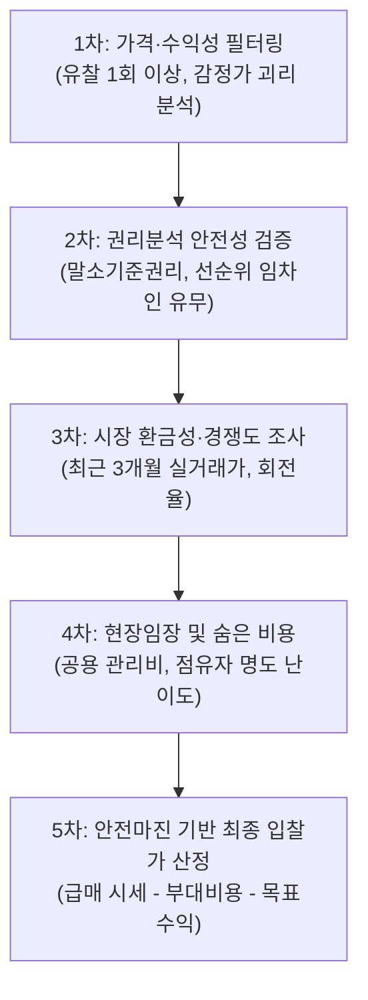

# 🏢 대한민국 법원 부동산 경매 종합 가이드 및 실시간 분석 보고서

> **문서 개요**  
> 본 보고서는 대법원 법원경매의 기초 개념(부산동경매, 소멸주의, 법원 관할, 선별 지표)부터 대한민국 법원경매정보([courtauction.go.kr](https://www.courtauction.go.kr))의 실시간 전수 데이터 수집, 다차원 가치평가 모델 설계, 전국 권역별 추천 및 대전광역시 TOP 50 추천 물건의 정밀 분석 결과까지의 모든 내용을 체계적으로 집대성한 문서입니다.

---

## 📑 목차
1. [부산동경매의 정의 및 특징](#1-부산동경매의-정의-및-특징)
2. [전국 법원경매 응찰 장소 (총 60개 입찰법정)](#2-전국-법원경매-응찰-장소-총-60개-입찰법정)
3. [국내 주요 경매·공매 사이트 주소 및 활용법](#3-국내-주요-경매공매-사이트-주소-및-활용법)
4. [경매 물건 선별 5대 지표 및 실전 체크리스트](#4-경매-물건-선별-5대-지표-및-실전-체크리스트)
5. [경매의 핵심 엔진: 소멸주의(消滅主義) 심층 분석](#5-경매의-핵심-엔진-소멸주의消滅主義-심층-분석)
6. [전국 권역별 경매 데이터 수집 및 알짜 추천 결과](#6-전국-권역별-경매-데이터-수집-및-알짜-추천-결과)
7. [대전광역시 경매 전수 수집 및 TOP 50 가치평가 모델](#7-대전광역시-경매-전수-수집-및-top-50-가치평가-모델)
8. [프로젝트 작업 환경 및 생성 파일 목록](#8-프로젝트-작업-환경-및-생성-파일-목록)

---

## 1. 부산동경매의 정의 및 특징

‘부산동경매’는 경매 실무에서 주로 **부산지방법원 동부지원(약칭: 부산동 / 부산동부)**에서 진행되는 법원경매를 의미하며, 문맥에 따라 부산광역시 동구 지역 경매 또는 비철금속 동(구리, 銅) 경매를 가리키기도 합니다.

### 1.1 부산지방법원 동부지원 경매 (주요 의미)
* **관할 구역 (4개 시·구·군):** **해운대구, 수영구, 남구, 기장군**
* **법원 소재지:** 부산광역시 해운대구 재반로112번길 20 (재송동, 동해선 센텀역 인근)
* **입찰 진행 시간:** 
  * 입찰표 접수: 오전 10:00 ~ 오전 11:20
  * 개찰 진행: 오전 11:30 시작
* **시장 및 지역적 특징:**
  * **해운대구·수영구·남구:** 부산 최고의 부촌이자 주거 선호지(마린시티, 센텀시티, 남천동, 광안리, 대연 재개발)를 포함하여 아파트·주상복합 응찰자 수와 낙찰가율이 매우 높음.
  * **기장군:** 정관·일광신도시의 택지지구 아파트와 더불어 오시리아 관광단지 배후 상가, 토지, 임야, 공장 등 도농복합형·투자용 물건이 활발히 출회됨.

### 1.2 부산광역시 ‘동구’ 지역 경매
* **관할 법원 주의:** 행정구역이 '부산 동구(초량·범일·수정·좌천동)'인 물건은 동부지원이 아니라 **부산지방법원 본원**(연제구 거제동 소재)에서 관할합니다.
* **특징:** 북항 재개발 사업 및 원도심 주택 재개발·상업시설 물건 중심.

---

## 2. 전국 법원경매 응찰 장소 (총 60개 입찰법정)

대한민국 법원경매는 **현장 방문 입찰이 원칙**이며, 부동산 소재지를 관할하는 지방법원 본원 및 지원 입찰법정에 직접 출석하여 응찰해야 합니다. (전국 18개 본원 + 42개 지원 = 총 60개소)

| 권역 | 본원 및 지원 목록 (응찰 장소) | 관할 구역 요약 |
| :--- | :--- | :--- |
| **서울 (5)** | 서울중앙, 서울동부, 서울서부, 서울남부, 서울북부 | 서울특별시 25개 자치구 분할 관할 |
| **인천·경기북부 (5)** | 인천지법 본원, 부천지원, 의정부지법 본원, 고양지원, 남양주지원 | 인천 전역, 김포, 부천, 의정부, 고양, 파주, 남양주, 구리 등 |
| **경기남부 (6)** | 수원지법 본원, 성남지원, 여주지원, 평택지원, 안산지원, 안양지원 | 수원, 용인, 화성, 성남, 하남, 광주, 평택, 안산, 시흥, 안양 등 |
| **강원권 (5)** | 춘천지법 본원, 강릉지원, 원주지원, 속초지원, 영월지원 | 춘천, 강릉, 동해, 삼척, 원주, 속초, 양양, 영월, 태백 등 |
| **대전·충청권 (10)** | 대전지법 본원, 홍성, 논산, 천안, 공주, 서산지원 / 청주지법 본원, 충주, 제천, 영동지원 | 대전, 세종, 충남 전역, 충북 전역 |
| **영남권 (19)** | 부산 본원, 부산동부, 부산서부 / 울산 본원 / 창원 본원, 마산, 진주, 통영, 밀양, 거창 / 대구 본원, 대구서부, 안동, 경주, 포항, 김천, 상주, 의성, 영덕 | 부산·울산·경남 전역, 대구·경북 전역 |
| **호남·제주권 (10)**| 광주 본원, 목포, 장흥, 순천, 해남지원 / 전주 본원, 군산, 정읍, 남원지원 / 제주지법 본원 | 광주·전남 전역, 전북 전역, 제주특별자치도 전역 |

> 📌 **입찰 준비물:** 신분증, 도장(막도장 가능), 입찰보증금(최저매각가격의 10%, 은행 수표 1장 권장). 대리 입찰 시 인감증명서(3개월 이내), 위임장(인감날인), 대리인 신분증/도장 지참 필수.

---

## 3. 국내 주요 경매·공매 사이트 주소 및 활용법

### 3.1 국가 공식 무료 플랫폼 (필수)
* **[대한민국 법원 법원경매정보](https://www.courtauction.go.kr):** 대법원 공식 사이트. 매각물건명세서, 감정평가서, 현황조사서 원본을 법적 공신력을 가지고 무료 열람 가능.
* **[온비드 (KAMCO 공매)](https://www.onbid.co.kr):** 한국자산관리공사 운영. 압류재산, 국유재산, 신탁공매를 온라인(PC/모바일)으로 전국 어디서나 전자입찰 가능.

### 3.2 민간 경매 플랫폼
* **무료 / 부분유료:**
  * **[마당스](https://www.madangs.com):** 직관적인 인터페이스와 넓은 무료 권리분석 열람 범위 제공.
  * **[밸류맵](https://www.valuemap.co.kr):** 토지·건물 실거래가 지도 및 경매 데이터 융합 검색.
  * **[리치고](https://www.richgo.ai):** 아파트 시세 예측 AI 및 경매 데이터 분석.
* **전문 유료 사이트 (등기부·세대열람 통합):**
  * **[지지옥션](https://www.ggi.co.kr)**, **[굿옥션](https://www.goodauction.com)**, **[탱크옥션](https://www.tankauction.com)**, **[옥션원](https://www.auction1.co.kr)**, **[스피드옥션](https://www.speedauction.co.kr)**

---

## 4. 경매 물건 선별 5대 지표 및 실전 체크리스트

좋은 경매 물건은 단순한 ‘유찰 횟수’가 아니라 아래 5대 지표의 복합 검증을 통해 판별합니다.

### 4.1 5대 핵심 지표
1. **가격 및 안전마진 지표:**
   * **감정평가액:** 6개월~2년 전 기준이므로 맹신 금지, 현재 네이버 부동산 최저 호가(급매가)와 비교.
   * **안전마진 공식:** $\text{안전마진} = \text{현재 급매 시세} - \text{총 취득원가 (낙찰가 + 세금 + 명도비 + 수리비)}$
2. **권리분석 리스크 지표:**
   * 말소기준권리 이후 권리 소멸 여부 확인.
   * 대항력 있는 선순위 임차인의 배당요구 및 미배당 보증금 인수액(0원이어야 안전).
3. **시장 경쟁도 및 환금성 지표:**
   * 평균 응찰자 수 및 최근 3개월 실거래량(환금성).
4. **명도 및 숨은 비용 지표:**
   * 소유자/임차인 점유 형태 및 배당 수령 여부 (전액 배당받는 임차인은 명도 수월).
   * 아파트·상가 공용부분 미납 관리비(낙찰자 인수 대상).
5. **물리적·입지 가치 지표:**
   * 아파트: 전세가율($\frac{\text{전세가}}{\text{매매가}} \times 100$), 대단지(300세대 이상), 역세권.
   * 상가: 공실률, 전용률, 실질 임대수익률(Cap Rate).
   * 토지: 맹지 여부(지적도상 도로 접합), 용도지역(건폐율·용적률).

---

## 5. 경매의 핵심 엔진: 소멸주의(消滅主義) 심층 분석

### 5.1 소멸주의와 인수주의의 비교
* **소멸주의(消滅主義, 삭제주의):** 매각대금을 완납하면 부동산 등기부상의 모든 담보물권과 압류 채권이 낙찰자에게 승계되지 않고 **법원의 촉탁으로 전부 지워지는 원칙** (민사집행법 제91조 제2항).
* **인수주의(引受主義):** 권리가 소멸하지 않고 낙찰자가 그 부담(빚, 보증금 등)을 고스란히 떠안아야 하는 원칙.

### 5.2 소멸의 기준: '말소기준권리' 5총사
등기부등본 접수일자가 가장 빠른 다음 권리가 기준선이 됩니다:
1. **(근)저당권**
2. **(가)압류**
3. **담보가등기**
4. **경매기입등기 (경매개시결정등기)**
5. **전세권** (건물 전부에 설정되고 배당요구 또는 경매신청한 경우)

> **원칙:** 말소기준권리를 포함하여 **그 이후에 설정된 모든 후순위 권리는 잔금 납부 시 전부 소멸(말소)**됩니다.

### 5.3 소멸되지 않는 예외 (낙찰자 인수 주의사항)
* **대항력 있는 선순위 임차인:** 말소기준권리보다 전입일이 빠르고, 보증금을 법원에서 전액 배당받지 못한 경우 낙찰자가 잔여 보증금을 물어줘야 함.
* **선순위 가처분 / 선순위 가등기:** 소유권 분쟁 소지가 있어 낙찰 후 소유권을 상실할 위험 존재.
* **특수권리:** 등기부 외 권리인 유치권(공사대금), 법정지상권(토지·건물 소유주 불일치).

---

## 6. 전국 권역별 경매 데이터 수집 및 알짜 추천 결과

### 6.1 전국 데이터 수집 개요
* **수집 대상:** 대한민국 17개 시·도 아파트/주거용 경매 물건 (유찰 1회 이상)
* **총 수집 건수:** **1,287건** (유효 물건 전수 정제 완료)
* **결과 저장 파일:** [대한민국법원_전국경매물건_정리_및_권역별추천.xlsx](file:///C:/Users/wood/Desktop/aiwork/auction/대한민국법원_전국경매물건_정리_및_권역별추천.xlsx)

### 6.2 권역별 대표 추천 물건 요약

| 권역 | 관할법원 | 사건번호 | 용도 | 소재지 및 단지명 | 감정가 | 최저매각가격 | 할인율 (유찰) |
| :--- | :---: | :---: | :---: | :--- | :---: | :---: | :---: |
| **수도권** | 부천지원 | 2024타경5702 | 아파트 | 경기 부천시 소사본동 삼신아파트 1동 3층 | 2.67억 | **9,158만 원** | **-65.7%** (3회) |
| **영남(부울경)** | 부산동부 | 2025타경462 | 아파트 | 부산 수영구 광안동 성우이린타워 9층 | 2.28억 | **7,820만 원** | **-65.7%** (3회) |
| **영남(부울경)** | 부산동부 | 2025타경634 | 아파트 | 부산 수영구 망미동 망미한신아파트 103동 2층 | 5.75억 | **1억 9,722만 원** | **-65.7%** (3회) |
| **영남(대경권)** | 대구지법 | 2025타경10173| 아파트 | 대구 동구 신서동 명가클래식 11층 | 1.91억 | **6,551만 원** | **-65.7%** (3회) |
| **충청권** | 대전지법 | 2025타경503447| 아파트 | 대전 대덕구 대화동 세원풍남아파트 5동 5층 | 1.66억 | **5,693만 원** | **-65.7%** (3회) |
| **충청권** | 대전지법 | 2025타경502901| 주거(도생)| 세종시 나성동 리베라아이누리 5층 | 1.23억 | **4,218만 원** | **-65.7%** (3회) |
| **호남권** | 광주지법 | 2025타경4860 | 아파트 | 광주 북구 문흥동 213동 1층 | 1.33억 | **5,958만 원** | **-55.2%** (2회) |
| **강원권** | 속초지원 | 2025타경10411| 아파트 | 강원 양양군 양양읍 양양서문주공 102동 6층 | 1.50억 | **5,145만 원** | **-65.7%** (3회) |

---

## 7. 대전광역시 경매 전수 수집 및 TOP 50 가치평가 모델

### 7.1 평가 모델 배점표 (100점 만점)
1. **가격 할인율 (배점 40점):** 60% 이상 할인 40점, 45~59% 할인 32점, 30~44% 할인 25점, 15~29% 할인 18점, 신건 10점.
2. **권리 안전성 (배점 30점):** 특수권리 없는 완전 소멸주의 30점 만점 (유치권·지분·법정지상권 발견 시 -15점 감점).
3. **용도 및 환금성 (배점 20점):** 아파트/주상복합 20점, 오피스텔/빌라 16점, 다가구/상가주택 14점, 근린상가 12점, 토지 10점.
4. **자치구별 입지 (배점 10점):** 유성구 10점, 서구(둔산·도안) 9점, 중구 7점, 동구 6점, 대덕구 6점.

### 7.2 대전 전수 수집 통계
* **총 수집 데이터:** 대전 관내 진행 물건 **522건 전수 수집** $\rightarrow$ 중복 제거 및 분석 대상 **311건 정제**.
* **결과 저장 파일:** [대전광역시_경매물건_TOP50_추천.xlsx](file:///C:/Users/wood/Desktop/aiwork/auction/대전광역시_경매물건_TOP50_추천.xlsx)

### 7.3 대전광역시 경매 베스트 TOP 10 물건

| 순위 | 점수 | 자치구 | 사건번호 | 용도 | 소재지 및 단지명 | 감정평가액 | 최저매각가격 | 할인율 (유찰) | 추천 사유 |
| :---: | :---: | :---: | :---: | :---: | :--- | :---: | :---: | :---: | :--- |
| **1위** | **100** | **유성구** | **2025타경503878** | 아파트 | 송강동 **청솔아파트** 102동 7층 | 1억 5,900만 | **3,817만 원** | **-76.0%** (3회) | 대덕R&D특구 배후, 3천만 원대 초저가, 권리 안전 |
| **2위** | **99** | **서구** | **2025타경502021** | 아파트 | 월평동 **에코리움** 5층 | 1억 8,000만 | **3,025만 원** | **-83.2%** (4회) | 둔산 인접 역세권 소형 주거, 감정가 대비 83% 할인 |
| **3위** | **96** | **유성구** | **2025타경503678** | 오피스텔 | 봉명동 **사이언스타운** 6층 | 2억 | **3,361만 원** | **-83.2%** (4회) | 유성온천역 역세권 초고층 주상복합단지 오피스텔 |
| **4위** | **96** | **유성구** | **2024타경109647** | 근린상가 | 봉명동 **유성자이** 1층 133호 | 2억 7,600만 | **4,638만 원** | **-83.2%** (4회) | 대단지 주상복합 1층 단지내 상가, 4천만 원대 취득 |
| **5위** | **96** | **유성구** | **2024타경8362** | 다세대 | 덕명동 **베네디또빌** 1층 102호 | 4억 1,300만 | **9,916만 원** | **-76.0%** (3회) | 수통골 인근 신축급 빌라, 4억대에서 1억 미만 급락 |
| **6위** | **96** | **유성구** | **2024타경8362** | 다세대 | 덕명동 **베네디또빌** 1층 101호 | 4억 3,400만 | **1억 420만 원** | **-76.0%** (3회) | 102호와 동일 단지 매물로 실거주·임대 세팅 최적 |
| **7위** | **96** | **유성구** | **2025타경3894** | 빌라 | 봉명동 다세대 5층 | 9,400만 | **3,224만 원** | **-65.7%** (3회) | 온천역 인근 소형 주거, 소액 월세 세팅 유리 |
| **8위** | **96** | **대덕구** | **2025타경503447** | 아파트 | 대화동 **세원풍남아파트** 5동 5층 | 1억 6,600만 | **5,693만 원** | **-65.7%** (3회) | 전용 73.5㎡ 중소형 아파트가 5천만 원대, 산단 배후 |
| **9위** | **96** | **유성구** | **2026타경45** | 근린상가 | 용산동 **세안프라자** 3층 | 1억 7,500만 | **6,002만 원** | **-65.7%** (3회) | 대덕테크노밸리 중심상가, 학원·사무실 수요 풍부 |
| **10위** | **96** | **유성구** | **2025타경3906** | 근린상가 | 문지동 효성해링턴 배후 상가 3층 | 2억 3,600만 | **8,094만 원** | **-65.7%** (3회) | 연구단지 배후 상권, 8천만 원대 진입으로 수익 확보 |

---

## 8. 프로젝트 작업 환경 및 생성 파일 목록

### 8.1 작업 디렉터리 경로
* **루트 디렉터리:** `C:\Users\wood\Desktop\aiwork\auction`

### 8.2 핵심 데이터 및 자동화 스크립트 파일
1. **분석 보고서 (본 문서):**
   * [부동산_경매_종합_분석_보고서.md](file:///C:/Users/wood/Desktop/aiwork/auction/부동산_경매_종합_분석_보고서.md)
2. **생성된 엑셀 분석 결과물:**
   * [대전광역시_경매물건_TOP50_추천.xlsx](file:///C:/Users/wood/Desktop/aiwork/auction/대전광역시_경매물건_TOP50_추천.xlsx) (대전 전수 522건 수집, 점수별 TOP 50 엄선)
   * [대한민국법원_전국경매물건_정리_및_권역별추천.xlsx](file:///C:/Users/wood/Desktop/aiwork/auction/대한민국법원_전국경매물건_정리_및_권역별추천.xlsx) (전국 17개 시도 1,287건 수집 및 권역별 추천)
3. **파이썬 데이터 파이프라인 스크립트:**
   * [process_daejeon_top50.py](file:///C:/Users/wood/Desktop/aiwork/auction/process_daejeon_top50.py): 대전 전수 수집 및 100점 만점 가치평가 모델 엑셀 빌더
   * [collect_and_export_auction.py](file:///C:/Users/wood/Desktop/aiwork/auction/collect_and_export_auction.py): 전국 17개 시도 실시간 크롤러 및 권역별 엑셀 익스포터
   * [check_daejeon.py](file:///C:/Users/wood/Desktop/aiwork/auction/check_daejeon.py): 대전 종별 건수 검증 스크립트
   * [print_summary.py](file:///C:/Users/wood/Desktop/aiwork/auction/print_summary.py): 엑셀 데이터 콘솔 요약 검증 스크립트
