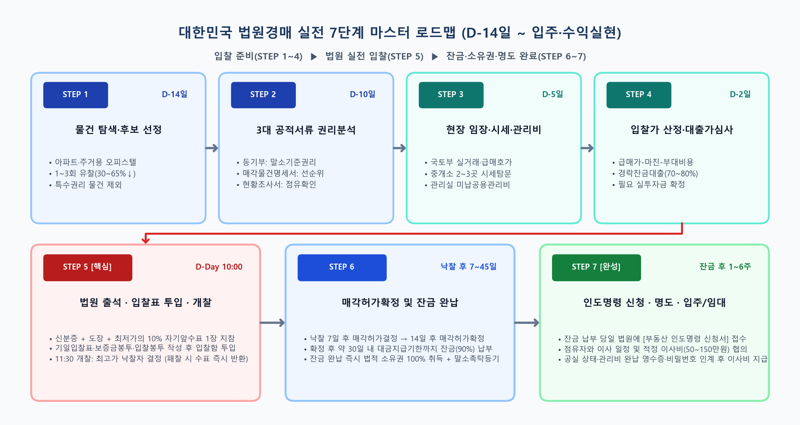
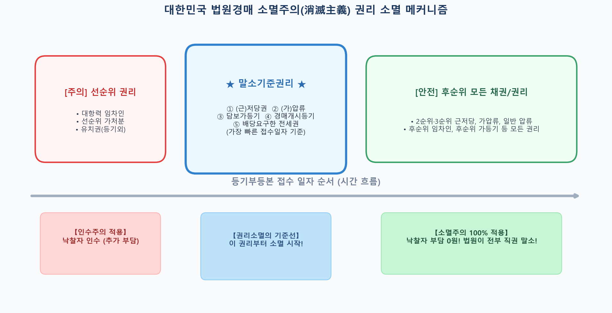
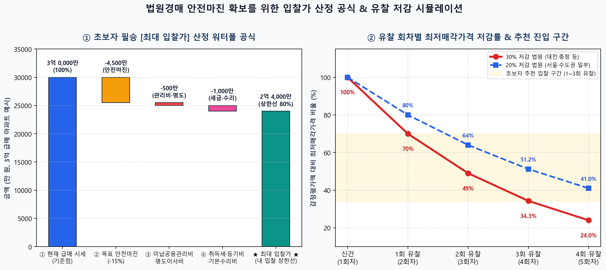
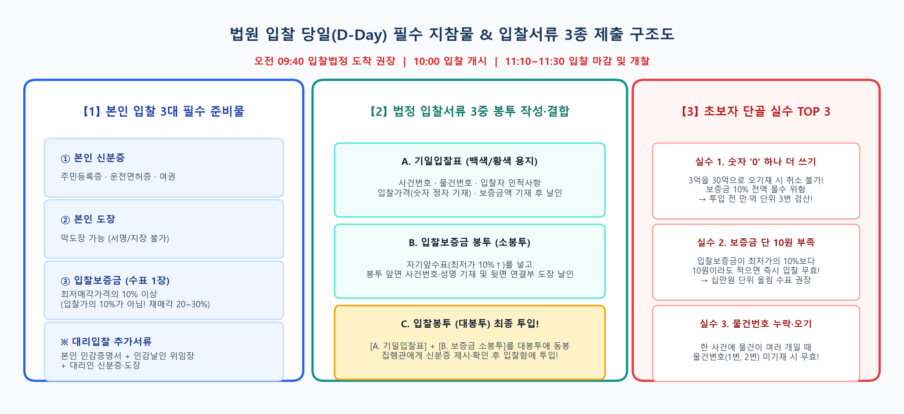
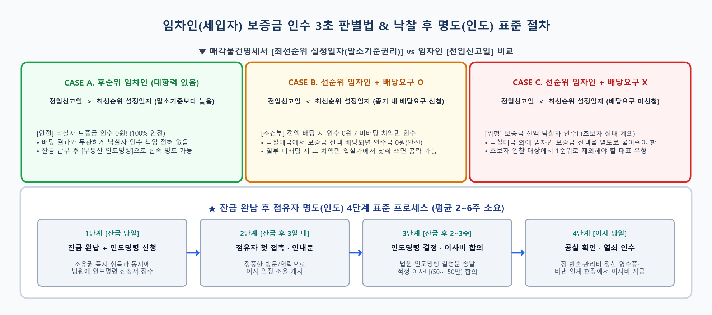

# 🧭 초보자를 위한 대한민국 법원경매 실전 진행 가이드 (A to Z)

> **대상**: 법원 부동산 경매에 처음 도전하는 입문자 및 실수요자·소액 투자자  
> **핵심 원칙**: 대한민국 민사집행법 **소멸주의(제91조 제2항)** 이해 및 **7단계 표준 프로세스** 준수

---

## 1. 한눈에 보는 법원경매 진행 7단계 타임라인

| 단계 | 시점 | 핵심 과제 | 초보자 핵심 포인트 |
| :--- | :--- | :--- | :--- |
| **STEP 1** | **D-14일** | **물건 검색 및 후보 선정** | 유찰 1~3회, 특수권리(유치권·지분·법정지상권) 없는 주거용(아파트·오피스텔) 선별 |
| **STEP 2** | **D-10일** | **3대 공적 서류 권리분석** | 등기부등본(말소기준권리), 매각물건명세서(선순위 임차인 유무), 현황조사서 열람 |
| **STEP 3** | **D-5일** | **현장 임장 및 시세·관리비 조사** | 급매 실거래가 확인, 공인중개소 2~3곳 방문, 관리사무소 미납 공용관리비 확인 |
| **STEP 4** | **D-2일** | **입찰가 산정 및 대출 가심사** | 목표 입찰가 산출 공식 적용, 경락잔금대출 가능 한도(70~80%) 사전 확인 |
| **STEP 5** | **D-Day (10:00)** | **법원 출석 및 입찰표 제출** | 신분증·도장·**최저가의 10% 자기앞수표** 지참, 기일입찰표 작성 및 투입 |
| **STEP 6** | **낙찰 후 7~45일** | **매각허가확정 및 잔금 납부** | 낙찰 1주 후 허가결정 → 1주 후 확정 → 30일 내 잔금 완납(완납 즉시 소유권 취득) |
| **STEP 7** | **잔금 후 1~6주** | **명도(인도) 및 입주·수익 실현** | 인도명령 신청, 점유자 이사 협의(공과금 정산·공실 확인 후 이사비 지급) |

---

## 2. 단계별 상세 실전 매뉴얼

### STEP 1. 물건 검색 및 후보 선정 (D-14일)
- **초보자 추천 물건**: 환금성과 시세 파악이 쉬운 **아파트·주상복합·주거용 오피스텔** 중 **1~3회 유찰(할인율 30~65%)**된 물건부터 시작하세요.
- **초보자가 피해야 할 위험 물건**: `토지·건물 지분경매`, `유치권 신고`, `법정지상권`, `선순위 가처분/가등기`, `위반건축물` 표시가 있는 물건은 입문 단계에서 제외하는 것이 안전합니다.

### STEP 2. 3대 필수 서류 권리분석 (D-10일)
1. **등기부등본 — 말소기준권리 찾기**:
   - 등기부 전체에서 **근저당권, 저당권, 압류, 가압류, 담보가등기, 경매기입등기** 중 접수일자가 **가장 빠른 권리**가 바로 **말소기준권리**입니다.
   - 낙찰자가 잔금을 완납하면 말소기준권리와 그 이후의 모든 권리는 법원 촉탁으로 **100% 직권 말소(소멸주의)**됩니다.
2. **매각물건명세서 (매각기일 7일 전 공개 — 가장 중요!)**:
   - 법원이 공식 작성한 권리분석 요약서입니다.
   - 좌측 상단 **[최선순위 설정일자]**보다 **전입신고일이 빠른 선순위 임차인**이 있는지, 있다면 배당요구를 했는지 반드시 확인하세요.
   - 하단 **[비고란 / 매각에 따라 설정된 것으로 보는 지상권 등]**에 인수 조건이 없다면 안전한 물건입니다.
3. **현황조사서 & 감정평가서**:
   - 집행관이 현장을 방문해 조사한 점유자 현황과, 감정평가사가 평가한 시점·건물 구조를 확인합니다.

### STEP 3. 현장 임장(답사) 및 시세·관리비 조사 (D-5일)
- **감정가를 시세로 착각하지 마세요**: 감정평가액은 6개월~1년 전 기준이므로 반드시 **국토교통부 실거래가**와 **네이버부동산 현재 급매 호가**를 확인해야 합니다.
- **공인중개사 최소 2~3곳 방문**: *"경매로 낙찰받으려는데 지금 당장 급매로 내놓으면 얼마에 팔릴까요? 전세/월세는 얼마에 바로 나가나요?"*를 질문해 보수적 시세를 파악하세요.
- **관리사무소 방문**: 아파트의 경우 전 소유자가 체납한 관리비 중 **공용부분(일반관리비·경비비·청소비 등)**은 판례상 낙찰자가 인수하므로 미납 개월 수와 금액을 미리 파악해 입찰가에서 차감해야 합니다.

### STEP 4. 목표 입찰가 산정 및 경락잔금대출 가심사 (D-2일)
- **초보자 입찰가 산정 공식**:
  $$\text{최대 입찰가} = \text{현재 급매 시세} - \text{목표 수익(안전마진)} - (\text{취득세} + \text{법무등기비} + \text{미납 공용관리비} + \text{명도 이사비} + \text{수리비})$$
- **경락잔금대출 사전 확인**:
  - 낙찰 후 잔금을 못 내면 입찰보증금(10%)을 몰수당합니다.
  - 입찰 전에 대출 상담사를 통해 본인의 소득(DSR)과 물건지 기준 **경락잔금대출 한도(통상 낙찰가의 70~80% 또는 감정가의 60% 중 작은 금액)**를 미리 확인하세요.

### STEP 5. 법원 입찰 당일 실전 가이드 (D-Day, 오전 10:00)

- **입찰 유형별 필수 준비물**:
  - **본인 직접 입찰**: 본인 신분증, 도장(막도장 가능), **입찰보증금(최저매각가격의 10% 이상 자기앞수표 1장)**
  - **대리인 입찰**: 대리인 신분증·도장 + 본인 인감증명서(3개월 이내) + 본인 인감도장이 날인된 위임장(기일입찰표 뒷면) + 입찰보증금
  - **법인 입찰**: 법인등기부등본, 법인인감도장, 대표자 신분증(직원 대리 시 법인인감증명서·위임장·대리인 신분증·도장) + 입찰보증금
- **초보자 단골 실수 TOP 3**:
  1. **입찰보증금 계산 착오**: 보증금은 내가 쓰는 입찰가의 10%가 아니라 **법원이 공고한 최저매각가격의 10%**입니다. (10원이라도 부족하면 무효! 단, 재매각 사건은 20~30%인지 공고문 확인)
  2. **입찰가 숫자 '0' 하나 더 적기**: 한 번 입찰함에 넣은 입찰표는 수정·취소가 절대 불가능합니다. 억/천만/백만 단위를 세 번 검산하세요.
  3. **사건번호·물건번호 누락**: 한 사건에 물건번호(1번, 2번 등)가 여러 개인 경우 반드시 물건번호까지 정확히 기재해야 합니다.

### STEP 6. 매각허가결정 및 잔금 납부 (낙찰 후 7일 ~ 45일)
- **일정 흐름**:
  - **개찰 당일**: 최고가매수신고인 선정 및 입찰보증금 영수증 수령 (패찰자는 현장에서 즉시 수표 반환)
  - **낙찰 후 7일**: 법원 **매각허가결정** 선고
  - **낙찰 후 14일**: 이의신청이 없으면 **매각허가확정**
  - **확정 후 약 30일 이내**: 법원이 지정한 대금지급기한까지 나머지 잔금(낙찰가 - 보증금 10%) 납부
- **소유권 취득**: 잔금을 완납하는 순간 등기부 기재와 관계없이 법적 소유권을 100% 취득하며, 동시에 경락잔금대출 실행 및 소유권이전등기·말소촉탁등기를 진행합니다.

### STEP 7. 명도(인도) 및 입주·수익 실현 (잔금 후 1~6주)
- **인도명령 신청**: 잔금 납부 당일 법원 민사집행과에 **부동산 인도명령 신청서**를 접수합니다. (소유자·채무자·대항력 없는 임차인 상대로 약 2~3주 내 인도명령 결정문이 나옵니다.)
- **원만한 명도 협상 팁**:
  - 잔금 납부 후 점유자에게 정중한 안내문을 전달하고 이사 일정을 조율합니다.
  - 강제집행 비용(약 200~350만 원)과 시간을 아끼기 위해 적정 수준의 **이사비(통상 50~150만 원 내외)**를 지원하되, 반드시 **이삿짐을 모두 빼고 공과금·관리비 정산 영수증 및 도어락 비밀번호를 넘겨받는 현장에서** 이사비를 지급하세요.

